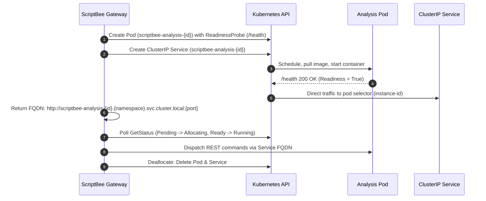

# Architecture Diagram

The OIDC provider can be any provider that supports the OpenID Connect protocol, such as Azure AD, Auth0, or Keycloak.

The OPA server is responsible for enforcing the RBAC policies defined in the OPA rules file. The OPA server can be
configured to use different data sources for user roles and permissions, such as a database or an external identity
provider.

See [Authentication](https://dxworks.org/scriptbee/architecture/configuration/gateway_configuration.html#authentication) for more information on how to configure the OPA server.

## Kubernetes Analysis Instance Lifecycle

