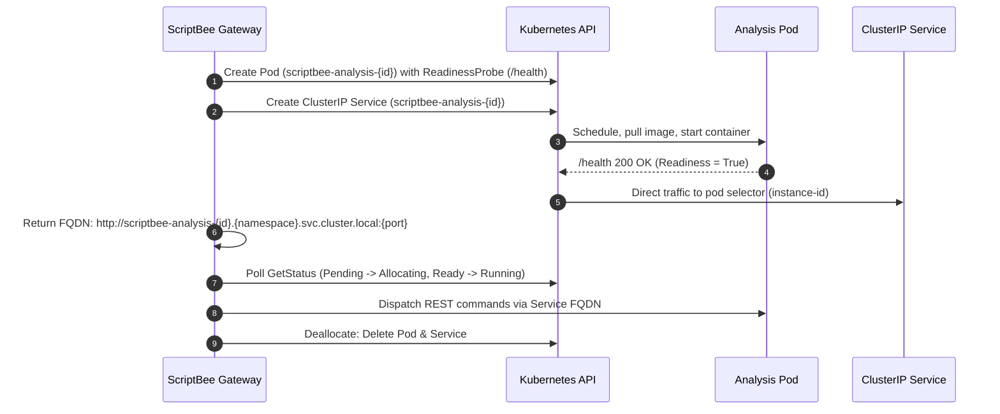

# Kubernetes Deployment

ScriptBee can run natively on Kubernetes, managing Analysis instances as Kubernetes workloads (`Pod` + `ClusterIP Service`) rather than local Docker containers.

## Overview & Architecture

When running on Kubernetes, the ScriptBee Gateway interacts directly with the Kubernetes API to orchestrate dynamic Analysis instances:

- **Isolated Workloads**: Each Analysis instance is provisioned as an independent Pod.
- **Predictable DNS**: Each Pod is accompanied by a `ClusterIP` Service, providing stable in-cluster addressing (`http://<pod-name>.<namespace>.svc.cluster.local:<port>`).
- **Health & Readiness**: An HTTP readiness probe (`/health`) ensures the Gateway routes analysis traffic and installs plugins only after ASP.NET Core is healthy.
- **Shared Storage**: Plugins and user project data are mounted via Kubernetes `PersistentVolumeClaim` (PVC) resources.

### Workload Lifecycle



---

## Driver Configuration

To enable the Kubernetes driver, set:

```dotenv
SCRIPTBEE__ANALYSIS__DRIVER=kubernetes
```

### Essential Settings

| Variable                                                | Description                               | Default            |
| :------------------------------------------------------ | :---------------------------------------- | :----------------- |
| `SCRIPTBEE__ANALYSIS__DRIVER`                           | Driver selector (`kubernetes`)            | `Docker`           |
| `SCRIPTBEE__ANALYSIS__KUBERNETES__NAMESPACE`            | Target namespace for Analysis Pods        | `default`          |
| `SCRIPTBEE__ANALYSIS__KUBERNETES__USERFOLDERVOLUMEPATH` | Mount path inside container for user data | `/root/.scriptbee` |
| `SCRIPTBEE__ANALYSIS__KUBERNETES__USERFOLDERPVCNAME`    | Name of PVC storing user project data     | _None_             |
| `SCRIPTBEE__ANALYSIS__KUBERNETES__PLUGINSPVCNAME`       | Name of PVC storing installed plugins     | _None_             |

See [Gateway Configuration](../architecture/configuration/gateway_configuration.md#scriptbee-analysis-kubernetes-namespace) for full details on resource limits, node selectors, and tolerations.

---

## RBAC Permissions

The ScriptBee Gateway requires RBAC permissions to create, monitor, and delete Pods and Services in the target namespace.

### ServiceAccount and Role

```yaml
apiVersion: v1
kind: ServiceAccount
metadata:
  name: scriptbee-gateway
  namespace: scriptbee
---
apiVersion: rbac.authorization.k8s.io/v1
kind: Role
metadata:
  name: scriptbee-analysis-manager
  namespace: scriptbee
rules:
  - apiGroups: ['']
    resources: ['pods', 'pods/status']
    verbs: ['get', 'list', 'watch', 'create', 'delete', 'update', 'patch']
  - apiGroups: ['']
    resources: ['services']
    verbs: ['get', 'list', 'watch', 'create', 'delete']
---
apiVersion: rbac.authorization.k8s.io/v1
kind: RoleBinding
metadata:
  name: scriptbee-gateway-analysis-binding
  namespace: scriptbee
subjects:
  - kind: ServiceAccount
    name: scriptbee-gateway
    namespace: scriptbee
roleRef:
  kind: Role
  name: scriptbee-analysis-manager
  apiGroup: rbac.authorization.k8s.io
```

---

## Quickstart

Ready-to-use manifests are located in the `quickstart/kubernetes/` directory.

### 1. Base Setup (Development Mode)

Runs MongoDB and ScriptBee Gateway with development authentication:

```bash
kubectl apply -f quickstart/kubernetes/base
```

Forward the Gateway port to access the UI:

```bash
kubectl port-forward -n scriptbee svc/scriptbee 4201:80
```

Open your browser at **`http://localhost:4201`**.

To stop:

```bash
kubectl delete -f quickstart/kubernetes/base
```

### 2. Full Setup (with Keycloak & OPA)

Runs MongoDB, Open Policy Agent (OPA) for authorization, Keycloak for identity management, and ScriptBee Gateway:

```bash
kubectl apply -f quickstart/kubernetes/full
```

Forward ports:

```bash
# Terminal 1: ScriptBee Gateway
kubectl port-forward -n scriptbee svc/scriptbee 4201:80

# Terminal 2: Keycloak
kubectl port-forward -n scriptbee svc/keycloak 8082:8080
```

Log in with default credentials `test` / `test`.

To stop:

```bash
kubectl delete -f quickstart/kubernetes/full
```
